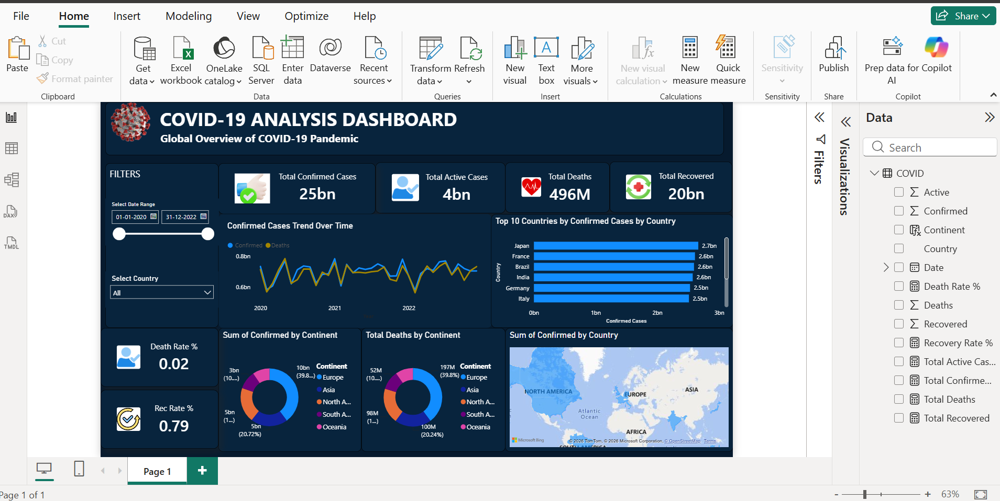

# 🦠 COVID-19 Analysis Dashboard | Power BI

## 📊 Project Overview

An interactive Power BI dashboard that analyzes the global impact of COVID-19 from January 2020 to December 2022.

## 🚀 Open Power BI Dashboard

### [📥 Click Here to Download COVID-19 Power BI Dashboard](./COVID-19.pbix)

Download the `.pbix` file and open it using Microsoft Power BI Desktop.

## 📷 Dashboard Preview

## 🎯 Project Objectives

- Analyze global COVID-19 cases.
- Track confirmed cases, active cases, deaths, and recoveries.
- Compare COVID-19 statistics across countries.
- Analyze cases and deaths by continent.
- Visualize geographical distribution using maps.
- Explore data through interactive filters.

## 🛠️ Tools & Technologies

- Microsoft Power BI
- Power Query
- DAX
- Data Visualization
- Data Analysis

## 📌 Dashboard KPIs

| KPI | Value |
|---|---:|
| Total Confirmed Cases | 25bn |
| Total Active Cases | 4bn |
| Total Deaths | 496M |
| Total Recovered | 20bn |
| Death Rate | 0.02 |
| Recovery Rate | 0.79 |

## 📈 Dashboard Features

1. KPI Cards
2. Confirmed Cases Trend Over Time
3. Top 10 Countries by Confirmed Cases
4. Confirmed Cases by Continent
5. Total Deaths by Continent
6. Geographical Map
7. Interactive Date and Country Filters

## 📅 Data Analysis Period

January 2020 – December 2022

## 🎓 Learning Outcomes

- Power BI dashboard development.
- Data visualization and analysis.
- KPI creation.
- Interactive report design.
- Geographic data visualization.

## 👨‍💻 Author
**Karan**

Data Analyst | Power BI | Python | SQL | Excel

⭐ If you find this project useful, please give this repository a star!